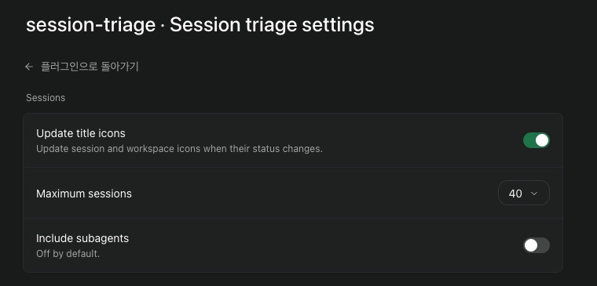

# Session triage for Paseo

See which Paseo sessions need your input, have a draft ready, are waiting on a result, or are done. Open a row to jump to that session. The sidebar shows how many sessions need attention. Filter the list by status, and open Icon guide when you need the emoji meanings.

Credit to [chaenmasahiro0425](https://github.com/chaenmasahiro0425) for [claude-session-triage](https://github.com/chaenmasahiro0425/claude-session-triage), the Claude Desktop skill that gave me the idea to mark sessions with emoji. This plugin is a separate implementation for Paseo. The original project is [MIT licensed](https://github.com/chaenmasahiro0425/claude-session-triage/blob/main/LICENSE).


Session titles, paths, and message text are redacted in this screenshot.

## Status icons

| Icon | Status | Meaning |
| --- | --- | --- |
| 🔴 | Error | Paseo reports an agent error. |
| ❓ | Needs your input | A permission request is pending, or the agent asks you to decide or reply. |
| 📤 | Ready to send | A draft appears ready. Review it before sending or posting. |
| 🟠 | Needs review | The work is unfinished, or the latest update is unclear. |
| 👀 | Waiting on a result | The agent appears to be waiting for CI, a build, a deployment, or a review. |
| ⏳ | Working | The agent is running a turn or starting up. |
| ○ | Idle | No active turn. Use Check reply to classify the latest response. |
| ✅ | Done | The latest reply says the work is done. Check the result yourself. |

Pending permission requests come from Paseo. Requests found in chat are inferred from the wording. A ✅ label does not verify that a build, test, deployment, or submission succeeded.

## Install

Requires stable Paseo 0.11.4 or later. Install the tagged GitHub version:

```sh
paseo plugin add git:sm1ee/paseo-session-triage --ref v0.1.12
paseo plugin ls session-triage
```

Open **Session triage** in the sidebar. To change the session limit or include subagents, open **Settings → Plugins → Session triage settings**.

The sidebar shortcut is hidden in the iOS and Android apps. Use **Open session triage** in the Command Center to open it there.



This screenshot is cropped from the actual settings screen. Host details are outside the crop.

For local development, clone this repository and run:

```sh
npm install --ignore-scripts
npm run typecheck
npm test
paseo plugin add /absolute/path/to/paseo-session-triage
```

If the CLI is not on your `PATH` on macOS, use `/Applications/Paseo.app/Contents/Resources/bin/paseo`. After changing local code, run `paseo plugin reload session-triage`.

The manifest declares only `>=0.11.4`, without a minor-version upper bound. Compatibility is checked with Paseo 0.11.4, 0.12.0, and 0.13.0. A future breaking API change may still need a plugin update. SDK and runtime dependencies remain pinned for reproducible builds.

## How it works

- The default view shows up to 20 recent top-level sessions. You can include subagents or raise the limit in Settings.
- The screen and sidebar check metadata every two minutes while open. Scans share an in-flight request, debounce events, and back off after failures.
- Automatic checks read metadata only. Idle sessions stay unclassified until you choose **Check reply**. That action reads up to 20 recent timeline items from one idle session. Results stay in memory while its metadata is unchanged.
- Chat-based labels are rules of thumb. Unclear replies and failed timeline reads show 🟠.
- **Update title icons** restores automatic session and workspace markers when enabled. It updates the affected session after a start, end, permission, or close event. Existing settings are respected. The initial bounded metadata scan also repairs old markers.
- Title updates run one at a time, at most once per 300 ms. Repeated events are merged, matching titles are skipped, and failures back off for one minute. One local authenticated connection handles agent names, without starting a CLI for each change.
- On Paseo 0.11 and 0.12, completed-turn events include recent messages. Triage uses up to 20 of those items without refetching a timeline. Paseo 0.13 sends an empty timeline, so the icon follows session metadata until you choose **Check reply**. The plugin does not add a background conversation fetch to replace the removed event data.
- The plugin cannot send messages, approve requests, stop agents, delete sessions, or archive them. It does not send conversation text to another model or external service. It keeps short excerpts in memory and settings in Paseo's host settings store.

## Paseo plugin catalog

The [publishing guide](https://paseo.sh/docs/plugins/publishing) explains how to submit this repository to the [Paseo plugin catalog](https://github.com/getpaseo/plugins/issues/new?template=submit-plugin.yml). A catalog listing for this visual plugin needs a screenshot of the actual interface with private details removed. Catalog approval gives it an `owner/slug` install name.
